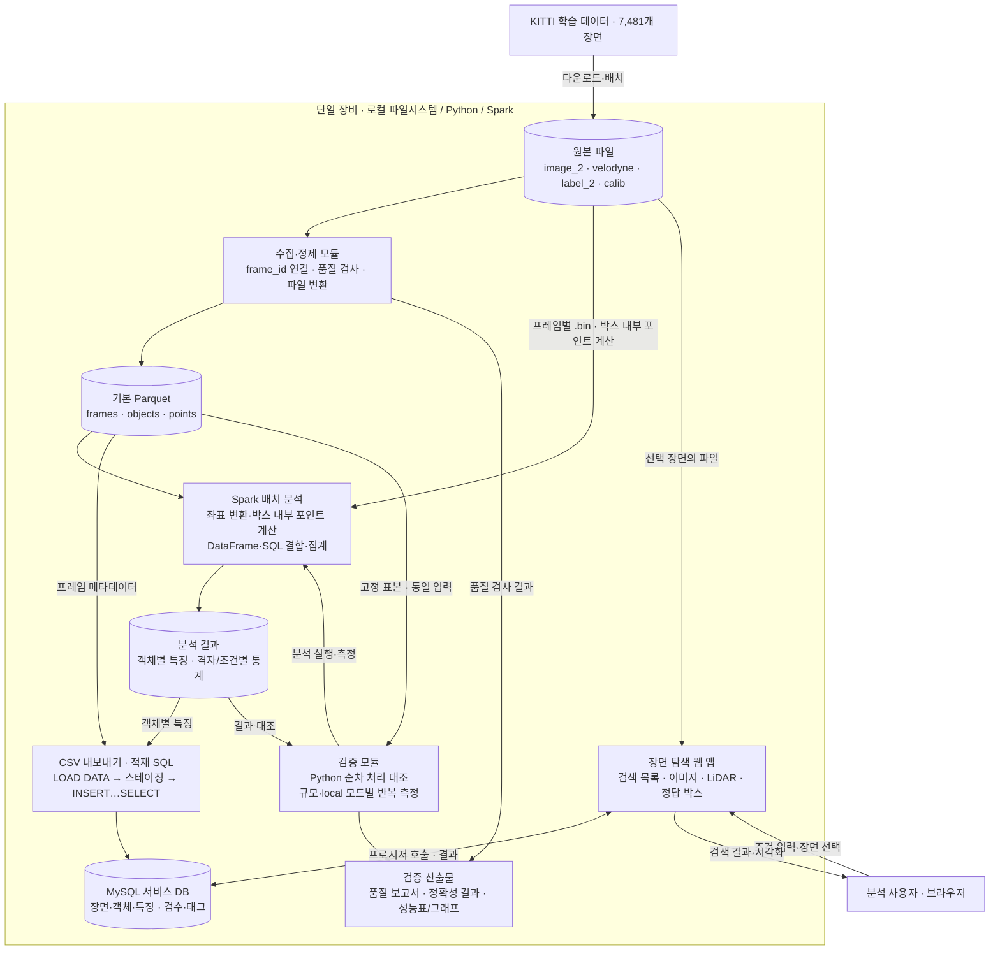
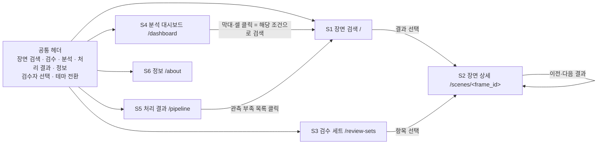

# 빅데이터분산처리시스템 — Final Project

[FinalProject.pdf](FinalProject.pdf)와 제안서·발표·보고서 제출란을 모았습니다.

## 실행 방법·결과 문서

| 문서 | 내용 | 관련 요구사항 |
| --- | --- | --- |
| [docs/RUNBOOK.md](docs/RUNBOOK.md) | 준비(Python·Java·MySQL), 데이터 배치, 실행 명령 순서와 기대 출력, 문제 해결 | N-2 |
| [docs/ENVIRONMENT.md](docs/ENVIRONMENT.md) | 측정 장비·소프트웨어 버전·측정 조건 | N-3 |
| [docs/RESULTS.md](docs/RESULTS.md) | 요구사항별 달성 상태, 핵심 수치, 성능 해석, 남은 일 | 전체 |
| [docs/USABILITY_TEST.md](docs/USABILITY_TEST.md) | 사용성 점검 절차와 기록 양식(점검 전) | U-13 |

## PDF의 요구사항

- **제안서(10점)**: 1쪽. 제목, 학생 이름, 프로젝트 목표(빅데이터 활용 계획), 요약(빅데이터 처리 방법), 일정과 주요 단계를 포함합니다.
- **발표(20점)**: 수업 중 5분 발표. 성과와 빅데이터 처리 내용을 보여주고, 어려웠던 점과 해결 방법을 설명합니다.
- **최종 보고서(10점)**: 제목, 학생 이름, 목표, 요약, 실제 달성한 일정을 포함합니다. 소스 파일과 테스트 결과를 함께 제출합니다. PDF는 GitHub 링크로 소스 제출을 대신할 수 있다고 안내합니다.

## 프로젝트 요구사항 명세서

제출한 [제안서](Proposal_2022271315_손한주_KITTI.pdf)(2026-10-21)를 기준으로 작성했습니다. 제안서에 없는 세부값(격자 크기, 관측량 기준값 등)은 **구현 시 확정**으로 표시했습니다. 거리 정의와 웹 검색 DB(MySQL)는 데이터베이스 과목 프로젝트와 맞추어 확정했습니다(2026-11-04).

### 1. 개요

| 항목 | 내용 |
| --- | --- |
| 제목 | KITTI 기반 자율주행 데이터 처리·인식 검증 |
| 학생 | 2022271315 손한주 |
| 목표 | 카메라·LiDAR·객체 정답을 연결하는 Spark 기반 병렬 처리 파이프라인을 구축한다. 거리·가림·관측 포인트 수에 따른 데이터 특성을 분석하고, 조건에 맞는 장면을 검색해 인식 모델 평가에 재사용할 수 있게 한다. |
| 실행 환경 | 단일 장비, Spark local 모드 (`local[1]`, `local[4]`, `local[8]`) |

### 2. 입력 데이터

| ID | 요구사항 |
| --- | --- |
| D-1 | KITTI Object Detection(3D) **학습 장면 7,481개**를 사용한다. 정답이 없는 시험 장면은 분석 대상에서 제외한다. |
| D-2 | 장면별로 왼쪽 카메라 이미지(`image_2`), LiDAR 점군(`velodyne`), 객체 라벨(`label_2`), 보정 정보(`calib`)를 사용한다. |
| D-3 | 공식 배포 용량(이미지 약 12GB, LiDAR 약 29GB, 학습·시험 포함)과 별개로, **실제 처리 용량과 총 포인트 수를 수집 후 측정해 기록**한다. |
| D-4 | 출처(KITTI Vision Benchmark Suite)와 이용 조건(CC BY-NC-SA 3.0)을 결과물에 명시한다. 원본 데이터는 저장소에 올리지 않는다. |

### 3. 기능 요구사항

#### ① 수집·정제

| ID | 요구사항 | 완료 기준 |
| --- | --- | --- |
| F-1 | 파일명에서 `frame_id`를 추출해 이미지·LiDAR·라벨·보정 파일을 한 장면으로 연결한다. | 7,481개 장면이 모두 4종 파일과 연결되거나, 연결되지 않은 장면이 목록으로 보고됨 |
| F-2 | 누락 파일, 중복 장면, 비정상 좌표(NaN·범위 밖 값 등)를 검사한다. `DontCare` 라벨은 무시 영역 표식이라 3D 값이 원래 무효(위치 -1000, 치수 -1, 회전 -10)이므로, 일반 객체의 좌표 오류와 **따로 센다**. `DontCare` 행은 지우지 않고 `is_dontcare=true`, `valid_3d=false`로 표시해 보존한다. | 검사 항목별 건수를 담은 품질 검사 보고서 생성(`DontCare` 건수와 일반 객체 오류 건수 분리) |
| F-3 | 프레임·객체·포인트 정보를 **명시적 스키마**의 Parquet 테이블로 변환한다. | 3개 테이블과 각 스키마 정의가 코드에 존재 |
| F-4 | 프레임 단위로 나누어 처리하며, 전체 데이터를 한 번에 메모리에 올리지 않는다. | 전체 변환이 메모리 부족 없이 끝까지 실행됨 |

#### ② 분석·조회

| ID | 요구사항 | 완료 기준 |
| --- | --- | --- |
| F-5 | Spark DataFrame과 Spark SQL로 테이블을 `frame_id` 기준으로 결합한다. | 같은 질의를 DataFrame·SQL 두 방식으로 실행해 결과 일치 |
| F-6 | 위에서 내려다본 평면을 공간 격자로 나누어 격자별 LiDAR 통계(포인트 수 등)를 Spark SQL로 집계한다. 통계는 **장면별**(`frame_id`, `grid_x`, `grid_y`)로 저장하고, 그림은 ① 모든 프레임의 같은 격자를 합산한 **전체 누적 히트맵**, ② 표본 장면의 장면별 그림 두 가지로 만든다. 평균을 그린다면 빈 격자를 0으로 넣고 정상 처리된 전체 프레임 수로 나눈다. 좌표계·원점·격자 크기·관심 영역은 모든 장면에서 같게 고정하고, 그 값은 구현 시 확정해 기록한다. 누적 히트맵은 센서 기준 상대 위치의 분포이며 지리 좌표 지도가 아니다. | 장면별 격자 통계 테이블, 전체 누적 히트맵, 표본 장면 그림 |
| F-7 | 객체 종류·거리·가림 정도별 분포를 집계한다. `DontCare`는 제외하고 그 건수는 품질 보고서에 따로 적는다. 라벨의 `truncated`(잘림) 값은 보존하고, KITTI 공식 난이도 적격 여부(`eligible_easy/moderate/hard`)를 보조 조건으로 만든다. 기준(2D 박스 높이 40/25/25 px, `occluded` ≤ 0/1/2, `truncated` ≤ 0.15/0.30/0.50)은 데이터베이스 과목의 `gt_object.diff_level` 생성 열과 같다. 등급은 누적이라 `eligible_moderate`는 `diff_level ≤ 2`와 같다. 거리는 **카메라 좌표 기준 수평거리 `√(x² + z²)`**(라벨 `location`의 x, z, 단위 m)로 정의한다. 데이터베이스 과목의 `gt_object.dist_m` 생성 열과 같은 정의다. | 조건별 통계 표와 그래프 |
| F-8 | 보정 정보로 좌표를 변환하고, **3D 박스 내부 LiDAR 포인트 수**를 객체마다 계산한다. `DontCare`와 3D 박스가 유효하지 않은 객체는 계산하지 않고 `NULL`로 두어 실제 포인트 수 0과 구분한다. 3D 박스가 유효한 조건은 **크기 `h`, `w`, `l`이 모두 양수이고 `location`의 `z > 0`** 인 경우이며, 데이터베이스 과목의 `gt_object.valid_3d` 생성 열과 같은 규칙이다. 박스 경계 위의 점은 포함하며 경계 여유 `1e-6 m`를 Spark·순차 처리에 똑같이 적용한다. | 객체 테이블에 포인트 수 열 추가, 표본 장면에서 시각적으로 검증 |
| F-9 | 포인트 수가 적은(관측량이 적은) 객체·장면을 추출한다. 유효한 3D 객체만 대상으로 한다. 기준값은 **클래스별 포인트 수 하위 10% 값**을 기본으로 하며, 분포를 확인해 확정한다. 확정한 값은 데이터베이스 과목의 `analysis_threshold`와 같게 맞춘다. | 추출 목록과 추출 기준 기록 |
| F-10 | 조건(객체 종류, 거리, 가림, 포인트 수 등)으로 장면을 검색하고, 카메라 이미지·LiDAR·정답 박스를 함께 보여주는 **장면 탐색 웹 화면**을 만든다. 웹 검색은 Spark 배치 결과를 적재한 **MySQL 서비스 DB**의 뷰·저장 프로시저로 조회한다. 이 DB와 웹 앱의 검수 기능은 데이터베이스 과목 프로젝트와 공유한다(7.4 참고). | 조건 입력 → 결과 목록 → 선택 장면의 세 가지 정보가 표시됨 |

#### ③ 정확성·성능 검증

| ID | 요구사항 | 완료 기준 |
| --- | --- | --- |
| F-11 | Spark 집계 결과를 **Python 순차 처리** 결과와 대조한다. 기준: 키 집합·중복·`NULL` 위치는 완전 일치. 객체 수·격자별 포인트 수·박스 내부 포인트 수·추출 목록은 정수 오차 0. 거리·평균 같은 부동소수 값은 `abs(a-b) <= 1e-6 + 1e-6 × abs(b)`. 좌표 변환과 집계는 `float64`로 계산하고 필드별 단위를 기록한다. | 위 기준으로 모든 대조 항목이 일치. 불일치는 원인과 함께 보고 |
| F-12 | 고정된 표본 **100 · 1,000 · 7,481개 장면**에서 순차 처리와 Spark `local[1/4/8]`의 처리 시간을 비교한다. 초기 비교에서는 파티션 수를 32로 고정하고 `local[N]`만 바꾼다. | 4개 실행 방식 × 3개 규모 결과표 |
| F-13 | 각 조건을 **3회 실행**하고 중앙값, 처리량, 메모리 사용량을 기록한다. 메모리는 매 실행을 새 프로세스로 시작하고 외부 측정기(`psutil`)가 100ms 간격으로 실행 Python·JVM·Python worker 등 **프로세스 트리의 RSS 합**을 샘플링해, 그 최댓값(MiB)을 ‘샘플링한 프로세스 트리 peak RSS’로 기록한다. 공유 페이지가 중복 계산될 수 있고 100ms보다 짧은 피크는 놓칠 수 있다는 한계를 함께 적는다. | 원시 측정값(메모리 시계열 포함)과 요약표가 함께 저장됨 |
| F-14 | 단일 장비에서의 병렬 처리 효과와 초기화·입출력 비용을 분석한다. | 속도 향상 그래프와 해석 |

### 4. 비기능 요구사항

| ID | 요구사항 |
| --- | --- |
| N-1 | **재현성**: 패키지 버전 고정(`requirements.txt` 등), 성능 비교에 쓰는 표본 장면 목록 고정, 사용한 데이터 버전 기록. |
| N-2 | **실행 방법 문서화**: 데이터 배치 → 변환 → 분석 → 검증 → 화면 실행 순서를 README로 제공한다. |
| N-3 | **측정 조건 기록**: CPU·코어 수·RAM·저장장치·OS·Spark/Java 버전을 성능 결과와 함께 남긴다. |
| N-4 | **확장성**: 같은 코드·스키마·분석 정의에서 입력 장면 목록과 실행 설정만 바꿔 100·1,000·7,481개 장면을 처리한다. 완료 기준: 4개 실행 방식 × 3개 규모 × 3회 = **36회 실행**이 모두 정상 종료하고, 누락·제외 사유가 모두 설명되며, F-11 정확성 기준을 만족하고, F-13 방식으로 잰 메모리가 실험 전에 정한 예산(물리 RAM의 80%) 안에 든다. 속도 향상 배수는 측정 결과로 보고할 뿐 완료 조건이 아니다. 이 기준이 입증하는 범위는 7,481개 장면까지다. |

### 5. 산출물

| 산출물 | 관련 요구사항 |
| --- | --- |
| 정제 데이터 생성 코드와 Parquet 테이블 | F-1 ~ F-4 |
| 품질 검사 결과 | F-2 |
| 조건별 통계 그래프 | F-6, F-7, F-9 |
| 처리 성능 비교표 | F-12 ~ F-14 |
| 장면 탐색 웹 화면 | F-10 |
| 소스와 실행·검증 방법 (GitHub 링크로 제출 가능) | N-1, N-2 |
| 5분 발표 자료: 성과, 빅데이터 처리 내용, 어려움과 해결 | 발표 요구사항 |
| 최종 보고서: 제목, 이름, 목표, 요약, **실제 달성 일정** | 보고서 요구사항 |

### 6. 프로젝트 범위

이번 프로젝트의 완료 범위는 **KITTI 학습 데이터를 정제·병렬 분석하고, 분석 결과로 원하는 장면을 검색·시각화하며, 처리 정확성과 성능을 검증하는 것**이다. 제목의 ‘인식 검증’은 이번 제출에서는 인식 모델 평가에 사용할 데이터의 특성과 장면을 확인하는 범위로 한정한다.

#### 6.1 In Scope — 포함 범위

| 구분 | 포함하는 작업과 결과 | 관련 요구사항 |
| --- | --- | --- |
| 데이터 수집·품질 검사 | KITTI 학습 장면 7,481개의 이미지·LiDAR·객체 정답·보정 정보를 연결하고, 누락·중복·비정상 좌표와 실제 처리 용량을 보고한다. | D-1 ~ D-4, F-1, F-2 |
| 구조화·저장 | 프레임·객체·포인트를 명시적 스키마의 Parquet 테이블로 변환한다. 프레임 단위로 나누어 처리한다. | F-3, F-4 |
| 병렬 분석·SQL 활용 | Spark DataFrame·SQL로 데이터를 결합하고, 공간 격자와 객체 종류·거리·가림 조건별 통계를 생성한다. | F-5 ~ F-7 |
| 객체 관측량 분석 | 좌표계를 맞추어 3D 정답 박스 내부 포인트 수를 계산하고, 관측량이 적은 객체·장면을 추출한다. | F-8, F-9 |
| 장면 탐색 화면 | 조건 검색, 결과 목록, 선택 장면의 카메라 이미지·LiDAR·정답 박스 표시를 제공한다. | F-10 |
| 정확성·성능 검증 | Python 순차 처리와 Spark 결과를 대조하고, 3개 데이터 규모에서 순차 처리 및 `local[1/4/8]`의 시간·처리량·메모리를 비교한다. 각 조건은 3회 실행한다. | F-11 ~ F-14 |
| 재현·제출 | 표본 목록·버전·실행 환경·측정 조건을 기록하고, 소스·실행 방법·검증 결과·발표·보고서를 제출한다. | N-1 ~ N-4, 산출물 전체 |

#### 6.2 Out of Scope — 제외 범위

| 구분 | 이번 제출에서 제외하는 작업 | 범위를 정한 이유 |
| --- | --- | --- |
| 추가 데이터 연동 | 정답 없는 KITTI 시험 장면 분석, 다른 데이터셋·자체 수집 차량 데이터 연동 | 정답이 제공되는 학습 장면과 지정된 4종 파일에 분석 대상을 고정한다. |
| 인식 모델 개발·평가 | 탐지 모델 학습·튜닝, 사전 학습 모델 추론 결과 연결, 모델 간 정확도 비교, 조건별 미검출 분석 | 제안서 3절의 모델 예측 연결은 **후속 확장**이다. 현재 검증 대상은 데이터 처리 결과와 처리 성능이다. |
| 실시간 자율주행 | 실시간 센서 수집·스트리밍, 차량 제어, 실제 차량에서의 주행 검증 | 저장된 KITTI 파일을 대상으로 배치 처리한다. |
| 다중 노드 운영 | 다중 서버 클러스터 구축·운영, 클라우드 배포 및 노드 간 확장 성능 검증 | 단일 장비의 Spark local 모드에서 병렬 처리 효과를 측정한다. |
| 상용 서비스 운영 | 회원·권한·결제, 다중 사용자 운영, 고가용성·운영 관제 체계 | 수업 시연과 분석에 사용할 로컬 장면 탐색 화면을 구현한다. 검수자(`reviewer`)는 시연용 식별자이며 로그인·권한 관리는 하지 않는다. 운영 기능은 빼지만, **화면 품질은 출시 수준을 목표로 한다**(9절). |
| 사업성 검증 | 사용자 인터뷰, 시장 조사, 고객 확보, 유료화 검증 | [서비스성 검토](KITTI_프로젝트_서비스성_검토.md)는 별도 참고 자료이며 과제 완료 기준에 포함하지 않는다. |

### 7. 목표 시스템 아키텍처

아래는 **구현 목표를 나타내는 설계**이며 구현 완료 상태를 뜻하지 않는다. 제안서의 단일 장비·Spark·Parquet·장면 탐색 요구사항을 구체화한 구조다. 웹 앱은 Flask + PyMySQL, 서비스 DB는 MySQL 8로 정했고, 거리 정의는 F-7을 따른다. 격자 크기, 관측량 기준값과 물리적 파티션 구성은 구현 시 확정하고 기록한다.

#### 7.1 전체 구성

시스템은 **배치 처리 → 분석 결과 저장 → 조건 검색·장면 표시**로 구성한다. 원본 파일과 Parquet은 로컬 파일시스템에 저장하고, Python 처리 코드·Spark 드라이버·병렬 작업·웹 애플리케이션을 같은 장비에서 실행한다. Spark는 `local[1]`, `local[4]`, `local[8]`로 실행하며, 성능 측정 중에는 웹 검색 등 다른 작업과 자원을 경쟁하지 않도록 한다.



MySQL 적재는 Spark 배치가 끝난 뒤 별도 단계로 실행한다. 성능 측정(F-12~F-14) 중에는 MySQL 서버와 웹 앱을 멈춰 자원 경쟁을 막는다.

구성요소를 선택해 살펴볼 수 있는 [대화형 아키텍처](.archify/architecture-kitti-target-20261104-124226/kitti-target.html)도 제공한다. 이 그림은 기본 Parquet의 `frames` 참조와 배치 분석 결과를 ‘검색·분석 데이터’로 묶어 표현한다. **주의:** 대화형 그림은 검수 전 버전이라 검색 모듈을 Spark SQL로, 박스 내부 포인트 계산 입력을 기본 Parquet으로 표시한다. 현재 설계(웹 검색은 MySQL, F-8 입력은 원본 `.bin`)는 위 Mermaid 그림과 이 문서의 본문이 기준이다.

#### 7.2 구성요소와 책임

| 구성요소 | 입력 | 책임과 출력 |
| --- | --- | --- |
| 원본 저장소 | KITTI의 4종 파일 | 원본을 보존하고 `frame_id`로 파일 경로를 연결한다. 이미지·점군은 선택 장면을 표시할 때도 읽는다. |
| 수집·정제 모듈 | 원본 파일 | 라벨·보정·점군을 해석하고 파일 연결과 데이터 품질을 검사한다. 정상 처리 데이터는 기본 Parquet으로, 누락·오류 내역은 품질 보고서로 저장한다. |
| 기본 데이터 저장소 | 정제된 프레임·객체·포인트 | 명시적 스키마의 Parquet을 저장한다. 테이블 결합·격자 집계·조건별 분포 계산에서 배치 분석과 순차 처리의 공통 입력으로 사용한다. |
| Spark 배치 분석 모듈 | 기본 Parquet, 원본 `.bin`, 보정 정보, 분석 설정 | 박스 내부 포인트 수는 프레임 목록을 고정 개수의 파티션으로 나눠 `mapInArrow`(Arrow 배치 단위의 `mapPartitions`)로 프레임마다 원본 `.bin`을 읽어 배열 연산으로 계산한다(셔플 없음, 점군을 드라이버로 모으지 않음). DataFrame·SQL로 테이블 결합·격자 집계·조건별 분포 계산을 수행한다. |
| 분석 결과 저장소 | 배치 분석 결과 | 객체별 거리·가림·포인트 수, 격자별 통계, 조건별 분포를 저장한다. 검색과 그래프 작성에 재사용한다. |
| 적재·검색 모듈 | 결과 Parquet, 화면의 조건 | 결과 Parquet을 CSV로 내보내 MySQL에 적재한다. 웹 앱은 MySQL 저장 프로시저를 호출해 조건에 맞는 객체를 찾고, 중복 없는 장면 목록과 표시용 메타데이터를 받는다. 웹 앱에 SparkSession을 상주시키지 않는다. 응답 지연은 따로 측정해 기록한다. |
| 장면 탐색 웹 앱 | 검색 결과, 선택한 `frame_id`의 원본·정답·보정 정보 | 조건 입력과 결과 목록을 제공하고 선택 장면의 이미지·LiDAR·정답 박스를 함께 표시한다. 검색 모듈은 같은 앱에서 호출하는 논리 모듈로 구성할 수 있다. 화면 구조·디자인 규칙·품질 기준은 9절을 따른다. |
| 검증 모듈 | 고정 표본, 동일 분석 설정, 순차·Spark 실행 결과 | 결과 일치 여부와 허용 오차를 검사한다. 실행 시간·처리량·메모리·환경 정보를 기록하고 비교표·그래프를 생성한다. |

#### 7.3 데이터 구조와 연결 기준

아래 이름과 필드는 목표 논리 구조다. 실제 자료형·널 허용 여부·좌표계·단위는 변환 코드의 스키마로 확정한다. 키의 유일성과 참조 관계는 품질 검사에서 확인한다.

| 테이블·결과 | 한 행의 의미 / 논리 키 | 주요 정보 |
| --- | --- | --- |
| `frames` | 장면 하나 / `frame_id` | 이미지·LiDAR·라벨·보정 파일 경로, 보정 행렬 등 장면 메타데이터 |
| `objects` | 장면 안의 정답 객체 하나 / (`frame_id`, `object_id`) | 객체 종류, 잘림(`truncated`), 가림 정도, 2D·3D 박스, 위치·크기·방향, `is_dontcare`, `valid_3d` |
| `points` | 장면 안의 LiDAR 포인트 하나 / (`frame_id`, `point_id`) | `x`, `y`, `z`, 반사 강도 |
| `object_features` | 객체별 분석 결과 하나 / (`frame_id`, `object_id`) | `objects`를 확장한 테이블. 거리·3D 박스 내부 포인트 수 등 검색용 특징 포함 |
| `grid_stats` | 장면 안의 평면 격자 하나 / (`frame_id`, `grid_x`, `grid_y`) | 해당 격자의 포인트 수 등 통계 |
| 조건별 분포 | 객체 종류·거리 구간·가림 등 조건 조합 하나 | 조합별 객체 수·포인트 수 통계 |
| 관측량 부족 목록 | 기준에 해당하는 객체 하나 / (`frame_id`, `object_id`) | 객체 특징과 추출 기준. 장면 목록은 `frame_id`의 중복을 제거해 생성 |

**식별자 생성 규칙.** KITTI 원본에는 객체 ID와 포인트 ID가 없으므로 다음처럼 파생한다.

- `object_id`: `label_2/<frame_id>.txt`의 **1부터 시작하는 원본 줄 번호**. `DontCare`·오류 행을 거르기 전에 붙이고, 이후 다시 번호를 매기지 않는다. 한 장면 안의 라벨 식별자일 뿐 여러 장면에 걸친 추적 ID가 아니다.
- `point_id`: 해당 `.bin` 안에서 포인트 레코드의 **0부터 시작하는 순서**. 비정상 포인트를 빼더라도 원본 인덱스를 유지한다.

**`points` 테이블 규모.** 장면당 약 12만 점을 가정하면 약 9억 행(120,000 × 7,481 = 897,720,000)이다. 실제 값은 각 `.bin`의 레코드 수를 합산해 D-3에 기록한다. 이 테이블은 F-6 격자 집계를 Spark SQL로 대규모 스캔·집계하는 데 쓰며, 변환 시간과 저장 용량도 함께 기록한다. 박스 내부 포인트 계산(F-8)은 이 테이블을 프레임별로 다시 모으지 않고 원본 `.bin`을 프레임 단위로 읽는다.

`frames`와 `objects`, `frames`와 `points`는 각각 1:N 관계다. 객체별 특징은 (`frame_id`, `object_id`)로 객체 정답과 연결한다. 한 장면의 모든 객체와 모든 포인트를 `frame_id`만으로 직접 조인하면 객체 수 × 포인트 수만큼 중간 행이 생기므로, **객체 내부 포인트 계산은 프레임별 수치 처리로 수행**한다. 장면 단위 통계 결합은 포인트를 먼저 집계한 결과를 사용한다.

#### 7.4 처리 흐름과 SQL의 역할

1. **수집·정제:** 원본 파일을 `frame_id`로 묶고 품질을 검사한 뒤 기본 Parquet을 생성한다. 전체 데이터를 한 번에 메모리에 올리지 않는다. 처리할 수 없는 장면과 원인은 보고서에 남긴다.
2. **특징 계산·집계:** 보정 정보를 이용한 좌표 변환과 박스 내부 포함 판정은 Python 수치 처리 코드에서 수행한다. Spark는 프레임 목록을 고정 개수(초기 32개)의 파티션으로 나눠 `mapInArrow`(Arrow 배치 단위의 `mapPartitions`)로 실행하고, 각 작업은 맡은 프레임의 원본 `.bin`·객체·보정 정보를 하나씩 읽어 객체별 결과를 반환한다. `groupBy(frame_id).applyInPandas`는 전체 셔플이 생기므로 쓰지 않는다. 순차 처리도 같은 `.bin`과 같은 유효성 정책을 쓴다. 계산한 객체별 특징을 저장하고, 격자·조건별 통계는 Parquet 테이블에서 Spark SQL로 생성한다.
3. **조건 검색:** 웹 앱이 전달한 객체 종류·거리·가림·포인트 수 조건을 MySQL에 적재한 객체 특징에 대한 저장 프로시저(`sp_search_scenes`)로 적용한다. 기본 검색 의미는 **한 객체가 입력한 조건을 모두 만족하는 장면**이며, 일치하는 객체를 찾은 뒤 `frame_id` 중복을 제거해 장면 목록을 반환한다.
4. **장면 표시:** 사용자가 고른 장면의 이미지·점군·정답·보정 정보를 읽어 표시한다. 검색 요청마다 전체 점군의 좌표 변환·박스 내부 포인트 계산을 다시 수행하지 않고 저장된 특징을 조회한다.
5. **검증:** 같은 표본·설정·집계 정의로 Python 순차 처리와 Spark를 실행해 결과를 대조한다. 동일 입력과 출력 범위를 기준으로 성능을 측정하고 통계·그래프를 저장한다.

| 처리 | SQL에서 담당하는 일 | 관련 요구사항 |
| --- | --- | --- |
| 테이블 결합 | `JOIN`으로 프레임과 객체 특징 또는 장면별 집계를 연결한다. 동일 질의를 DataFrame으로도 작성해 결과를 대조한다. | F-5 |
| 통계 생성 | `GROUP BY`, `COUNT`, `SUM`, `AVG` 등으로 격자별·객체 조건별 통계를 계산한다. | F-6, F-7 |
| 관측량 부족 데이터 추출 | 계산된 포인트 수에 `WHERE` 조건을 적용한다. | F-9 |
| 적재 (MySQL) | 결과를 CSV(NULL은 `\N`)로 내보내 `LOAD DATA`로 스테이징에 넣고, `INSERT … SELECT … ON DUPLICATE KEY UPDATE`로 반영한다. `DontCare`의 무효 표식(-1, -10, -1000)은 이때 NULL로 바꾸고, `DontCare` 객체의 특징 행은 `object_feature`에 넣지 않는다. 적재 후 Parquet과 MySQL의 행 수·NULL 수가 같은지 확인한다. | F-10, F-11 |
| 웹 조건 검색 (MySQL) | 적재된 객체 특징을 프로시저로 필터링하고 `DISTINCT frame_id`로 장면 목록을 구성한다. | F-10 |

SQL은 **Parquet에 저장한 구조화 데이터와 계산 결과를 결합·집계·검색하는 역할**을 맡는다. 배치 결합·집계와 성능 실험은 Parquet에 대한 Spark SQL이 맡는다. 웹 요청 조회·검수 기록·서비스 통계는 결과를 적재한 MySQL이 맡는다. 제안서가 Spark SQL을 쓰겠다고 한 곳은 배치의 테이블 결합·분석이며, 웹 요청까지 Spark로 처리하라는 요구는 없다. MySQL 스키마·프로시저·CRUD는 데이터베이스 과목 프로젝트 범위다([DB 제안서](../../데이터베이스/finalproject/proposal/Proposal_DB_2022271315_손한주_KITTI.md), [DB 요구사항·ERD](../../데이터베이스/finalproject/README.md), [ERD 그림](../../데이터베이스/finalproject/proposal/ERD_KITTI_DB.png)). 빅데이터 과목의 완료 기준은 Parquet·Spark 결과와 그 적재 정확성까지다. SQL 적용은 위 설계로 구체화하며, 기존 명세에서 DataFrame·SQL 결과 대조를 필수로 요구하는 항목은 F-5다.

#### 7.5 정확성·성능 검증 구조

검증 모듈은 고정된 **100·1,000·7,481개 장면 × Python 순차 처리 및 Spark `local[1/4/8]` × 3회 반복**을 관리한다. 각 구현의 입력 표본, 격자 크기, 거리 정의, 관측량 기준과 출력 집계 항목을 같게 맞춘다. 정수 건수는 완전 일치를, 부동소수 결과는 F-11의 허용 오차(`1e-6 + 1e-6 × |b|`)를 검사한다. 좌표 변환과 박스 내부 포인트 계산은 표본 장면의 시각적 확인을 함께 수행한다.

성능 결과에는 원시 측정값·중앙값·처리량·메모리 사용량과 실행 환경을 남긴다. Spark 초기화·파일 읽기·계산·결과 저장 중 어디까지 시간에 포함했는지, 캐시와 파티션을 어떻게 설정했는지도 기록한다. 결과 해석은 **단일 장비의 병렬 처리 효과와 초기화·입출력 비용**에 한정한다.

### 8. 일정

| 기간 | 주요 단계 | 관련 요구사항 |
| --- | --- | --- |
| 10/21 | 제안서 제출, 데이터·분석 범위 확정 | — |
| 10/22–11/1 | 표본 파일 해석·좌표 검증, 전체 학습 데이터 수집·검사 | D-1 ~ D-3, F-1, F-2 |
| 11/2–11/15 | Parquet 변환, Spark 집계, 장면 특징 생성. 병행: 와이어프레임·디자인 토큰·문구표 확정, 썸네일 생성 배치 | F-3 ~ F-9, U-1 ~ U-3 |
| 11/16–11/29 | 정확성·성능 비교, 탐색 화면과 분석 결과 완성 | F-10 ~ F-14, U-4 ~ U-12 |
| 11/30–12/8 | 사용성 점검(9.11, U-13)과 수정, 재현·검증 자료와 5분 발표 준비, 12/8 발표 | N-1 ~ N-3, U-13 |
| 12/9–12/15 | 최종 보고서·소스·검증 결과 정리와 제출 | 산출물 전체 |

### 9. UI/UX 설계

장면 탐색 웹 앱(F-10)은 **처음 보는 사람이 설명 없이 3분 안에 원하는 장면을 찾고 이해할 수 있는 수준**, 즉 바로 출시할 수 있는 수준의 완성도를 목표로 한다. 여기서 ‘출시 수준’은 **화면 품질**을 뜻한다. 일관된 디자인, 모든 상태(로딩·빈 결과·오류)의 처리, 접근성, 응답 속도, 명확한 문구가 그 기준이다. 로그인·배포·운영 같은 서비스 운영 기능은 6.2절대로 범위 밖이다.

웹 앱은 데이터베이스 과목 프로젝트와 공유한다. 이 절의 디자인 시스템·공통 레이아웃·상태 처리 규칙은 앱 전체에 적용한다. 화면별 기능의 소속은 9.3의 ‘소속’ 열로 구분한다.

#### 9.1 디자인 원칙

| 원칙 | 의미 | 화면에서의 적용 |
| --- | --- | --- |
| 데이터가 주인공 | 장식보다 이미지·점군·숫자가 먼저 보인다. | 무채색 바탕, 색은 객체 클래스와 상태 표시에만 쓴다. 그림자·그라데이션은 최소화한다. |
| 한 화면, 한 질문 | 각 화면은 하나의 질문에 답한다. | 검색 = “어떤 장면이 있나?”, 상세 = “이 장면은 어떤가?”, 처리 결과 = “데이터와 처리는 믿을 만한가?” |
| 연결된 시각화 | 같은 객체는 어디서나 같은 색·같은 번호로 보인다. | 객체 표·카메라 이미지·BEV 중 한 곳에 마우스를 올리면 나머지 두 곳에서도 강조된다. |
| 상태를 숨기지 않는다 | 사용자는 지금 적용된 조건과 시스템 상태를 항상 안다. | 적용 조건 칩, 결과 수, 기준값과 그 출처, 로딩·오류 상태를 항상 표시한다. |
| 용어는 한 번 정의하고 일관되게 쓴다 | ‘관측 부족’, ‘가림’, ‘거리’는 앱 전체에서 같은 뜻이다. | 용어 옆 ⓘ 툴팁과 정보 화면(S6)에 F-7·F-8·F-9 정의를 그대로 싣는다. |
| 되돌릴 수 있다 | 검색·탐색 동작은 언제든 되돌릴 수 있다. | 검색 조건을 URL에 담아 뒤로 가기·새로고침·링크 공유를 지원한다. 삭제처럼 되돌릴 수 없는 동작만 확인을 받는다. |

#### 9.2 사용자와 핵심 과업

| 사용자 | 목적 | 핵심 과업 (사용성 점검 시나리오와 동일) |
| --- | --- | --- |
| 인식 모델 평가자 | 어려운 조건의 장면을 모아 모델을 평가한다. | T1. “30 m 이상, 일부 가림인 보행자가 있는 장면”을 찾아 첫 결과의 상세를 연다. |
| 데이터 검수자 | 정답 라벨과 관측량의 문제를 찾는다. | T2. 관측 부족 객체가 있는 장면에서 해당 객체를 이미지와 BEV에서 찾아 판정을 남긴다. |
| 과목 평가자(교수·청중) | 빅데이터 처리가 실제로 잘 됐는지 확인한다. | T3. 품질 검사 결과와 Spark `local[8]`의 속도 향상 배수를 찾는다. |

#### 9.3 정보 구조와 화면 목록



| ID | 화면 | 답하는 질문 | 소속 | 데이터 출처 |
| --- | --- | --- | --- | --- |
| S1 | 장면 검색 | 조건에 맞는 장면은 무엇인가? | 공동 (F-10, DB FR-1·FR-6) | MySQL `sp_search_scenes` |
| S2 | 장면 상세 | 이 장면의 객체는 어떻게 보이고 얼마나 관측됐나? | 공동 (F-10, DB FR-2·FR-4) | MySQL + 원본 이미지·`.bin`·`calib` |
| S3 | 검수 세트 | 검수할 장면 묶음과 진행 상황은? | DB 과목 (FR-3·FR-4) | MySQL |
| S4 | 분석 대시보드 | 질문 1–4의 답은? | DB 과목 (FR-7) | MySQL 뷰 `v_q1`–`v_q4` |
| S5 | 처리 결과 | 데이터 품질·분포·정확성·성능은? | **빅데이터 과목** (F-2, F-6, F-7, F-9, F-11 ~ F-14) | 배치가 저장한 결과 파일(JSON·CSV·PNG) |
| S6 | 정보 | 용어 정의, 데이터 출처·라이선스는? | 공동 (D-4) | 정적 문서 |

S5는 배치가 미리 저장한 결과 파일만 읽는다. 웹 요청 중에 Spark를 실행하지 않는다(7.2).

#### 9.4 화면별 설계

**공통 레이아웃.** 상단 헤더(높이 56 px)에 앱 이름, 주 메뉴 5개, 검수자 선택, 라이트/다크 전환을 둔다. 하단 바닥글에는 “KITTI Vision Benchmark Suite · CC BY-NC-SA 3.0”을 모든 화면에 표시한다(D-4). 본문 최대 폭은 1440 px이며, 장면 상세만 전체 폭을 쓴다.

**S1 장면 검색**

```text
┌─────────────────────────────────────────────────────────────────────────┐
│ KITTI Scene Explorer   장면 검색  검수  분석  처리 결과  정보   [검수자▾] ◐ │
├──────────────────┬──────────────────────────────────────────────────────┤
│ 검색 조건         │ 장면 1,284개 · 객체 2,031개 일치          정렬 [거리 먼 순▾] │
│                  │ [보행자 ×] [30–80 m ×] [일부 가림 ×]          조건 모두 지우기 │
│ 프리셋 [추천 ▾]   │ ┌──────────┐ ┌──────────┐ ┌──────────┐ ┌──────────┐   │
│                  │ │ 썸네일    │ │ 썸네일    │ │ 썸네일    │ │ 썸네일    │   │
│ 객체 종류         │ │ 박스 겹침 │ │          │ │          │ │          │   │
│ ☑ 보행자 ☐ 차량 … │ ├──────────┤ ├──────────┤ ├──────────┤ ├──────────┤   │
│ 거리 (m)          │ │ 000123   │ │ 001045   │ │ …        │ │ …        │   │
│ [30]━━●━━━●[80]  │ │ 보행자 2 · │ │ 보행자 1 · │ │          │ │          │   │
│ 가림              │ │ 관측부족 1 │ │ 41 m      │ │          │ │          │   │
│ [0 보임][1 일부]… │ └──────────┘ └──────────┘ └──────────┘ └──────────┘   │
│ 포인트 수 [  ]–[ ] │                        …                              │
│ ☐ 관측 부족만 ⓘ   │                                                      │
│ ☐ 미검수만        │            ‹ 이전   1  2  3 … 54   다음 ›             │
│ 태그 [선택 ▾]     │                                                      │
│ [프리셋으로 저장] │                                                      │
└──────────────────┴──────────────────────────────────────────────────────┘
```

- **조건 패널(왼쪽 고정, 폭 280 px)**: 객체 종류(체크박스, 클래스 색 점 포함), 거리(이중 슬라이더 + 숫자 입력, 0–80 m, 5 m 단위), 가림(0 보임 · 1 일부 가림 · 2 대부분 가림 토글, 3 알 수 없음은 별도 체크), 포인트 수 범위, 관측 부족만, 미검수만, 태그.
- **즉시 반영**: 조건을 바꾸면 300 ms 디바운스 후 자동으로 검색한다. 별도의 ‘검색’ 버튼은 두지 않는다. 결과 영역만 다시 그리고, 패널의 스크롤·포커스는 유지한다.
- **적용 조건 칩**: 결과 위에 칩으로 보여주고, × 로 하나씩 해제한다. 결과 수는 ‘장면 N개 · 객체 M개’로 함께 표시한다. 검색 의미가 “한 객체가 모든 조건을 만족”이므로 객체 수도 같이 보여준다.
- **결과 카드**: 썸네일(정답 박스를 미리 그린 WebP, 폭 320 px), `frame_id`, 일치 객체 수, 최근접 거리, 관측 부족·검수 상태 배지. 한 페이지에 24개, 화면 폭에 따라 1–4열로 배치한다.
- **정렬**: 일치 객체 많은 순(기본) · 거리 먼 순 · 포인트 적은 순 · `frame_id` 순.
- **URL 동기화**: 모든 조건·정렬·페이지를 쿼리 문자열에 담는다. 예: `/?cls=Pedestrian&dmin=30&dmax=80&occ=1&page=2`.
- **빈 결과**: “조건에 맞는 장면이 없습니다”와 함께, 가장 좁은 조건 하나를 풀었을 때의 결과 수를 제안한다. 예: “거리 조건을 해제하면 312개”. 이 제안 수도 MySQL 프로시저가 계산하며, Python·JS에서 다시 세지 않는다(DB NR-1). 추천 프리셋(DB FR-8)도 보여준다.

**S2 장면 상세**

```text
┌─────────────────────────────────────────────────────────────────────────┐
│ ← 검색 결과 (12 / 1,284)   장면 000123        ‹ 이전  다음 ›   [링크 복사] │
├─────────────────────────────────────────────────────────────────────────┤
│ 카메라 이미지 (1242×375, 2D 박스 + 번호)                 레이어 [박스][라벨][DontCare]│
│ ┌─────────────────────────────────────────────────────────────────────┐ │
│ │      [1 차량]           [2 보행자]                [3 보행자·관측부족]   │ │
│ └─────────────────────────────────────────────────────────────────────┘ │
├───────────────────────────────┬─────────────────────────────────────────┤
│ LiDAR BEV (위에서 본 평면)      │ 객체 (7)                   필터 [전체 ▾]  │
│ ┌───────────────────────────┐ │ # 종류    거리  가림  잘림  포인트 난이도 판정│
│ │  · ·  ▭1    ·  ▭2  ·  ▭3  │ │ 1 차량   12.4m  보임  0.00  1,842  쉬움  ✓  │
│ │ ·  ·    ·   ·  ·    ·  ·  │ │ 2 보행자 31.0m  일부  0.00    96  보통  —  │
│ │       ▲ 센서               │ │ 3 보행자 47.8m  일부  0.12  ⚠ 9  어려움 —  │
│ └───────────────────────────┘ │ …                                        │
│ 색상 [높이▾]  확대 ±  초기화   │ 선택한 객체: 3 보행자 → [판정 남기기]       │
└───────────────────────────────┴─────────────────────────────────────────┘
```

- **세 가지 정보의 연결**: 객체 표의 행, 이미지의 2D 박스, BEV의 3D 박스 바닥면이 같은 번호와 같은 클래스 색을 쓴다. 한 곳에 마우스를 올리면 세 곳이 함께 강조되고, 클릭하면 선택이 고정된다.
- **카메라 이미지**: 원본 해상도 비율을 유지한다. 박스는 2 px 실선, 번호 라벨은 박스 왼쪽 위에 붙인다. `DontCare` 영역은 회색 빗금으로 표시하며 기본으로 꺼 둔다.
- **BEV**: Canvas 2D로 그린다. 관심 영역과 좌표계는 F-6과 같게 맞추고, 센서 위치와 진행 방향, 10 m 간격 거리 눈금을 표시한다. 점 색상은 높이 또는 반사 강도(순차 색상표 viridis) 중에서 고른다. 휠로 확대하고 드래그로 이동하며, ‘초기화’로 원래 화면에 돌아온다.
- **점군 전송**: 서버가 관심 영역 안의 점만 `float32` 바이너리(x, y, z, 반사 강도)로 보낸다. JSON으로 바꿔 보내지 않는다.
- **객체 표**: 열 머리를 눌러 정렬한다. 관측 부족 객체는 ⚠ 아이콘과 문구로 표시해 색에만 의존하지 않는다. 포인트 수가 `NULL`이면 “계산 안 함(3D 박스 무효)”으로 표시해 0과 구분한다(F-8).
- **탐색 흐름**: 검색 결과 안에서의 위치(12 / 1,284)와 이전·다음 버튼을 둔다. 키보드 `←`·`→`로 이동하고 `Esc`로 검색 결과로 돌아간다. 돌아가면 이전 스크롤 위치를 복원한다.
- **판정(DB 과목)**: 검수자를 선택했을 때만 ‘판정 남기기’를 활성화한다. 선택하지 않았으면 버튼 옆에 “헤더에서 검수자를 먼저 선택하세요”를 표시한다.

**S5 처리 결과 (빅데이터 과목 핵심 화면)**

탭 5개로 구성한다. 각 탭은 맨 위에 **한 줄 결론**을 두고, 그 아래에 근거 그래프·표, 맨 아래에 원본 파일 다운로드를 둔다.

| 탭 | 한 줄 결론 예시 | 그래프·표 | 요구사항 |
| --- | --- | --- | --- |
| 데이터 품질 | “7,481개 장면 중 7,481개 연결, 일반 객체 좌표 오류 0건” | 검사 항목별 건수 표(`DontCare`와 일반 오류 분리), 처리 용량·총 포인트 수 | D-3, F-1, F-2 |
| 분포 | “보행자의 62%가 20 m 이내” | 클래스 × 거리 구간 막대, 가림 정도별 누적 막대, 난이도 적격 비율 | F-7 |
| 공간 히트맵 | “포인트는 전방 0–20 m에 집중” | 전체 누적 히트맵(로그 색 척도, 범례·단위 포함), 표본 장면 그림 | F-6 |
| 관측 부족 | “클래스별 하위 10% 기준으로 객체 N개, 장면 M개” | 클래스별 포인트 수 분포와 기준선, 추출 목록(클릭하면 S1에서 해당 조건으로 검색) | F-9 |
| 정확성·성능 | “Spark와 순차 처리 결과 모든 항목 일치, 7,481개 장면에서 `local[8]`이 순차 대비 N배” | 대조 항목별 통과 표, 규모 × 실행 방식 처리 시간 그래프(3회 범위 표시), 메모리 peak 표, 측정 환경 | F-11 ~ F-14, N-3 |

결론 문장의 숫자는 결과 파일에서 채운다. 위 예시 숫자는 자리표시이며 실제 값이 아니다.

**S6 정보**: 용어 정의(거리 = 카메라 좌표 수평거리 `√(x² + z²)`, 가림 0–3의 뜻, 3D 박스 유효 조건, 관측 부족 기준값과 산출 일시), 데이터 출처·라이선스, 프로젝트·과목 정보를 싣는다.

#### 9.5 상태 처리

모든 데이터 영역은 아래 다섯 상태를 정의한다. 상태가 정의되지 않은 영역은 완성으로 보지 않는다.

| 상태 | 표시 방법 | 문구 예 |
| --- | --- | --- |
| 초기 | 기본 조건(전체 장면, 일치 객체 많은 순)으로 바로 결과를 보여준다. 빈 화면으로 시작하지 않는다. | — |
| 로딩 | 결과 카드 모양의 스켈레톤을 표시한다. 300 ms 안에 끝나면 아무것도 표시하지 않는다(깜빡임 방지). BEV는 진행 표시줄을 쓴다. | “점군 불러오는 중…” |
| 빈 결과 | 이유와 다음 행동을 제시한다. | “조건에 맞는 장면이 없습니다. 거리 조건을 해제하면 312개가 있습니다.” |
| 오류 | 무엇이 실패했는지, 사용자가 할 수 있는 일을 쓴다. 기술 정보는 ‘자세히’ 안에 넣는다. ‘다시 시도’ 버튼을 둔다. | “데이터베이스에 연결하지 못했습니다. MySQL 서버가 실행 중인지 확인하세요.” |
| 부분 성공 | 되는 부분은 보여주고 안 되는 부분만 표시한다. | 이미지는 표시하고 BEV 자리에 “이 장면의 LiDAR 파일을 찾지 못했습니다(000123.bin)” |

입력 검증은 입력 칸 바로 아래에 표시한다. 예: “최솟값이 최댓값보다 큽니다”. 저장·삭제가 끝나면 화면 오른쪽 아래에 4초짜리 알림을 띄운다. 판정 삭제에는 ‘되돌리기’를 두고, 세트 삭제는 확인 대화상자를 거친다(DB 과목 기능, 세부 규칙은 [DB 과목 README의 UI/UX 설계](../../데이터베이스/finalproject/README.md#uiux-설계)).

#### 9.6 디자인 시스템

모든 색·간격·글꼴은 CSS 변수(디자인 토큰)로 한 파일(`static/css/tokens.css`)에 정의한다. 화면 코드에 색상 값을 직접 쓰지 않는다.

**색 토큰 (라이트 / 다크)**

| 토큰 | 라이트 | 다크 | 용도 |
| --- | --- | --- | --- |
| `--bg` | `#FFFFFF` | `#0F1115` | 페이지 바탕 |
| `--surface` | `#F6F7F9` | `#171A21` | 패널·카드 |
| `--border` | `#E3E6EB` | `#2A2F3A` | 구분선 |
| `--text` | `#14171F` | `#E8EAEE` | 본문 |
| `--text-muted` | `#5B6372` | `#9AA3B2` | 보조 문구(바탕 대비 4.5:1 이상) |
| `--accent` | `#2457D6` | `#6E9BFF` | 링크·주요 버튼·포커스 |
| `--warn` | `#9E5300` | `#F0A63A` | 관측 부족 등 주의 |
| `--danger` | `#C62828` | `#FF6B6B` | 오류·삭제 |
| `--ok` | `#1E7F4F` | `#4CC38A` | 통과·완료 |

다크 테마는 기본으로 시스템 설정을 따르고, 헤더에서 바꿀 수 있다. 선택은 브라우저에 저장한다. 점군과 이미지는 어두운 바탕에서 잘 보이므로 S2 시각화 영역은 라이트 테마에서도 어두운 바탕을 쓴다.

**객체 클래스 색**: 색각 이상에도 구분되는 Okabe–Ito 팔레트를 쓰고, 항상 글자 라벨과 함께 표시한다.

| 클래스 | 표시 이름 | 색 |
| --- | --- | --- |
| Car | 차량 | `#0072B2` |
| Van | 승합차 | `#56B4E9` |
| Truck | 트럭 | `#E69F00` |
| Pedestrian | 보행자 | `#D55E00` |
| Person_sitting | 앉은 사람 | `#F0E442` (밝은 바탕에서는 진한 외곽선 추가) |
| Cyclist | 자전거 | `#009E73` |
| Tram | 트램 | `#CC79A7` |
| Misc | 기타 | `#8C8C8C` |
| DontCare | 무시 영역 | 회색 빗금 |

**글꼴·크기·간격**

- 글꼴: 본문 Pretendard, `frame_id`·숫자 표는 JetBrains Mono(고정폭, `font-variant-numeric: tabular-nums`). 시연 장비가 오프라인일 수 있으므로 글꼴 파일은 앱에 포함한다(CDN 사용 안 함).
- 글자 크기: 12 / 14(본문) / 16 / 20 / 24 / 32 px의 6단계만 쓴다.
- 간격: 4 px 단위(4·8·12·16·24·32·48)만 쓴다. 모서리 반경은 6 px, 카드 그림자는 1단계만 쓴다.
- 숫자 표기: 천 단위 쉼표, 거리는 소수 1자리 + ` m`, 비율은 소수 1자리 %. 표의 숫자는 오른쪽으로 정렬한다.

**공통 컴포넌트**: 버튼(주·보조·위험 3종), 체크박스·토글, 이중 범위 슬라이더, 조건 칩, 배지(관측 부족·검수 상태·난이도), 결과 카드, 정렬 가능한 표, 탭, 툴팁, 알림, 스켈레톤, 빈 상태·오류 상태 블록. 컴포넌트는 Jinja2 매크로로 한 번 정의하고 모든 화면에서 재사용한다.

#### 9.7 시각화 규칙

- 모든 그래프에 제목, 축 이름과 단위, 데이터 출처(결과 파일명·생성 일시)를 표시한다.
- 범주는 클래스 색을 쓰고, 연속 값은 viridis, 히트맵처럼 값 범위가 넓으면 로그 척도를 쓰고 범례에 그 사실을 적는다. 무지개 색상표는 쓰지 않는다.
- 성능 그래프는 3회 실행의 중앙값을 점으로, 최솟값–최댓값을 오차 막대로 그린다(F-13). 속도 향상은 순차 처리 대비 배수로 표시하고, 이상적인 선형 증가선을 점선으로 함께 그린다.
- 마우스를 올리면 정확한 값을 툴팁으로 보여준다. 그래프마다 같은 데이터를 표로 보는 ‘표로 보기’ 전환을 둔다(접근성).
- 그래프 라이브러리는 Chart.js 하나로 통일하고 파일을 앱에 포함한다. 히트맵과 장면 그림은 배치가 만든 PNG를 쓴다.

#### 9.8 접근성·반응형

- WCAG 2.1 AA 기준을 따른다. 본문 대비 4.5:1 이상, 큰 글자·그래픽 3:1 이상.
- 모든 기능은 키보드로 쓸 수 있다. 포커스 테두리는 2 px `--accent`로 항상 보인다. 단축키는 `/`(검색 조건으로 이동), `←`·`→`(이전·다음 장면), `Esc`(돌아가기), `?`(단축키 도움말)이다.
- 색만으로 정보를 전달하지 않는다. 클래스는 글자, 관측 부족은 ⚠와 문구, 통과·실패는 ✓·✕ 기호를 함께 쓴다.
- 이미지와 그래프에는 대체 텍스트를 단다. 예: “장면 000123 카메라 이미지, 정답 객체 7개”.
- 기준 화면은 1440×900(시연 장비)이며 1280 px 이상에서 모든 기능을 쓸 수 있게 한다. 1024 px 이하에서는 조건 패널을 접이식 서랍으로 바꾸고, S2는 이미지 → BEV → 객체 표 순서의 세로 배치로 바꾼다. 모바일(390 px)에서는 검색과 상세 보기까지 지원하고, 검수 입력은 지원하지 않는다고 안내한다.

#### 9.9 성능 기준

측정 조건은 로컬 장비, MySQL과 웹 앱만 실행 중인 상태다(성능 실험과 동시에 실행하지 않음, 7.1).

| 항목 | 목표 |
| --- | --- |
| 검색 응답(조건 변경 → 결과 표시) | 95백분위 500 ms 이하 |
| 장면 상세 첫 표시(이미지와 객체 표) | 1초 이하 |
| BEV 표시(점군 전송 + 그리기) | 1.5초 이하, 확대·이동 중 30 fps 이상 |
| 결과 카드 썸네일 | 배치에서 미리 생성한 WebP(장당 30 KB 이하), 화면에 들어올 때 불러오기 |
| 페이지 용량(썸네일 제외) | CSS·JS 합계 300 KB 이하, 프런트엔드 빌드 도구 없이 동작 |

썸네일은 Spark 배치 뒤에 별도 단계로 한 번 생성한다(`thumbnails/<frame_id>.webp`, 7,481개). 원본 데이터처럼 저장소에는 올리지 않는다(D-4).

#### 9.10 문구 원칙

- 한국어 존댓말, 짧은 문장을 쓴다. 버튼은 동작으로 쓴다(‘저장’ ✕ → ‘프리셋 저장’ ○).
- 내부 이름(`valid_3d`, `diff_level`)은 화면에 그대로 노출하지 않고 표시 이름을 쓴다. 표시 이름은 문구표 한 곳(`app/i18n/ko.py`)에서 관리한다.
- 같은 개념은 같은 단어로 쓴다. ‘장면’(frame), ‘객체’(object), ‘관측 부족’, ‘가림’, ‘잘림’, ‘포인트 수’로 통일하고 ‘프레임’, ‘오브젝트’ 같은 혼용을 금지한다.
- 오류 문구는 ‘무엇이 → 왜 → 어떻게’ 순서로 쓰고, 사용자를 탓하지 않는다.

#### 9.11 UI 요구사항과 완료 기준

| ID | 요구사항 | 완료 기준 |
| --- | --- | --- |
| U-1 | 와이어프레임 | S1–S6 와이어프레임이 확정되어 `docs/ui/`에 저장됨 |
| U-2 | 디자인 토큰과 공통 컴포넌트 | `tokens.css`와 Jinja2 매크로가 존재하고, 화면 코드에 색상 값 직접 사용 0건(`grep`으로 확인) |
| U-3 | 썸네일 생성 | 7,481개 썸네일 생성, 누락 0건 또는 누락 목록 보고 |
| U-4 | 검색 화면 | 9.4 S1의 모든 조건·칩·정렬·URL 동기화가 동작하고, 결과가 MySQL 콘솔의 `CALL sp_search_scenes(…)`와 같음 |
| U-5 | 장면 상세 연결 강조 | 표·이미지·BEV 중 어디서 선택해도 세 곳이 같은 객체를 강조함 |
| U-6 | BEV와 좌표 일치 | 표본 장면 5개에서 BEV의 3D 박스 안에 F-8이 센 포인트가 실제로 들어 있음을 눈으로 확인하고 캡처를 남김 |
| U-7 | 처리 결과 화면 | S5의 5개 탭이 결과 파일을 읽어 표시하고, 한 줄 결론의 숫자가 결과 파일 값과 같음 |
| U-8 | 상태 처리 | 모든 데이터 영역에서 9.5의 다섯 상태를 재현할 수 있음(MySQL 중지, 파일 삭제 등으로 시험) |
| U-9 | 접근성 | Lighthouse 접근성 점수 95 이상(S1·S2·S5), 마우스 없이 T1 과업 완료 가능 |
| U-10 | 반응형 | 1440·1024·390 px에서 가로 스크롤과 겹침 없음 |
| U-11 | 성능 | 9.9 목표를 측정해 기록하고, 미달 항목은 원인과 함께 보고 |
| U-12 | 다크 테마 | 두 테마 모두 9.6의 대비 기준을 만족 |
| U-13 | 사용성 점검 | 아래 방법으로 점검하고 발견한 문제와 조치를 기록 |

**사용성 점검(U-13).** 프로젝트를 모르는 사람 3–5명에게 설명 없이 9.2의 과업 T1–T3을 맡긴다. 성공 여부, 걸린 시간, 막힌 지점을 기록한다. 목표는 **과업 성공률 90% 이상, 과업당 중앙값 3분 이내**다. 두 명 이상이 같은 곳에서 막히면 출시 차단 문제로 보고 발표 전에 수정한다.

#### 9.12 기술 선택

| 영역 | 선택 | 이유 |
| --- | --- | --- |
| 서버·템플릿 | Flask + Jinja2 (7절 결정) | 서버 렌더링으로 첫 화면이 빠르고 빌드 단계가 없다. |
| 부분 갱신 | 바닐라 JS `fetch`로 결과 영역 HTML 조각 교체 | 검색 결과만 다시 그려 SPA 없이도 즉시 반응한다. |
| BEV | Canvas 2D + `float32` 바이너리 | 장면당 약 12만 점을 WebGL 없이도 30 fps로 그릴 수 있다. 부족하면 관심 영역 잘라내기와 간격 추출을 적용한다. |
| 그래프 | Chart.js(로컬 파일) | 한 가지 라이브러리로 통일하고 오프라인에서도 동작한다. |
| 글꼴 | Pretendard, JetBrains Mono(로컬 파일) | 한글 가독성, 숫자 정렬 |

3D 점군 뷰어(WebGL)와 LiDAR 점을 카메라 이미지에 겹쳐 그리는 기능은 **시간이 남을 때의 선택 기능**으로 두고, 완료 기준에는 넣지 않는다.

## 마감: 문서와 LMS 제출란 구분

| 단계 | PDF의 표기 | LMS 제출란 마감 (한국시간) |
| --- | --- | --- |
| 제안서 | 10/21 | 2026-10-21 23:59:59 |
| 발표 | 12/8 | 2026-12-08 09:00:00 |
| 보고서 | 12/16, 문서 상단 23:59 | 2026-12-15 23:59:59 |

**보고서 날짜는 PDF와 LMS 제출란이 하루 다릅니다.** PDF의 “Wednesday, December 16”은 2026-12-16의 실제 요일(수요일)과 맞지만, LMS 제출란은 **2026-12-15 23:59:59**에 닫힙니다. 어느 표기가 정정된 것인지 원문에서 확인되지 않으므로, 별도 정정 공지가 없는 한 **더 이른 LMS 마감 전에 제출**합니다. 위 일정(12/9–12/15)도 이 기준에 맞춰져 있습니다.

## 저장한 공지 원문

- [Final Project Presentation](%EA%B3%B5%EC%A7%80/assignments_251224_Final_Project_Presentation.md)
- [Final Project Report Submission](%EA%B3%B5%EC%A7%80/assignments_251225_Final_Project_Report_Submission.md)
- [Proposal submission](%EA%B3%B5%EC%A7%80/assignments_252558_Proposal_submission.md)

확인일: 2026-10-20T11:33:41.644668+09:00
